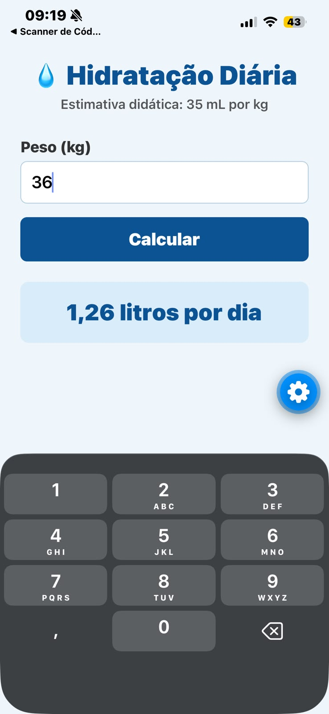

# Questão 01 — Hidratação Diária

Aplicativo React Native (Expo) que estima o consumo diário de água a partir do peso (35 mL por kg).

## Funcionalidades
- Campo de peso (kg) e botão **Calcular**
- Resultado em litros por dia (70 kg → 2,45 L)
- Validação de valores vazios, não numéricos, negativos ou zero

## Como executar
```bash
npx create-expo-app@latest q01-hidratacao --template blank
cd q01-hidratacao
# substitua o App.js pelo deste projeto
npx expo start
```
Abra com o **Expo Go** (QR code) ou cole o `App.js` em https://snack.expo.dev.

## Capturas de tela

<div align="center">
  
</div>
