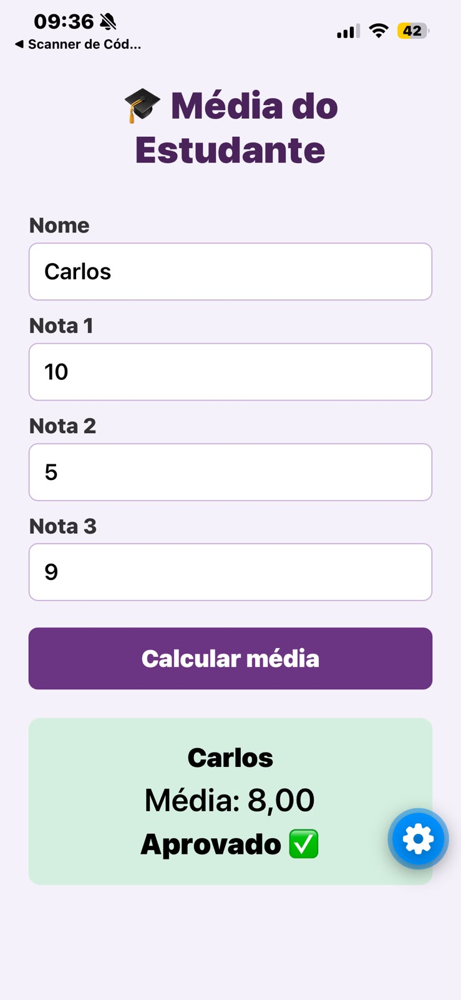

# Questão 02 — Média do Estudante

Aplicativo React Native (Expo) que calcula a média aritmética de três notas e informa a situação.

## Funcionalidades
- Campos: nome e três notas; botão **Calcular média**
- Aprovado com média ≥ 7,0 (8,0 / 7,0 / 9,0 → média 8,00; Aprovado)
- Validação: campos vazios, valores não numéricos e notas fora do intervalo 0–10

## Como executar
```bash
npx create-expo-app@latest q02-media-notas --template blank
cd q02-media-notas
# substitua o App.js pelo deste projeto
npx expo start
```
Abra com o **Expo Go** (QR code) ou cole o `App.js` em https://snack.expo.dev.

## Capturas de tela

<div align="center">
  
</div>
