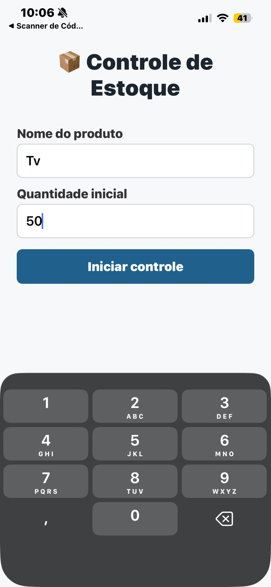
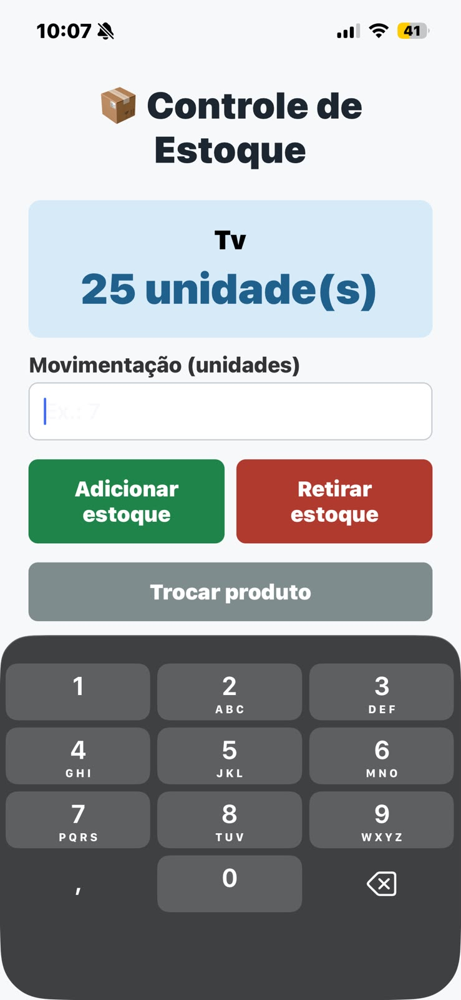
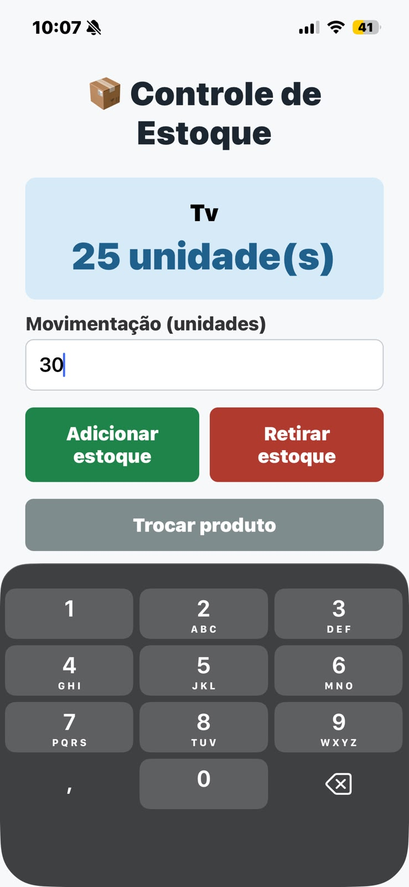
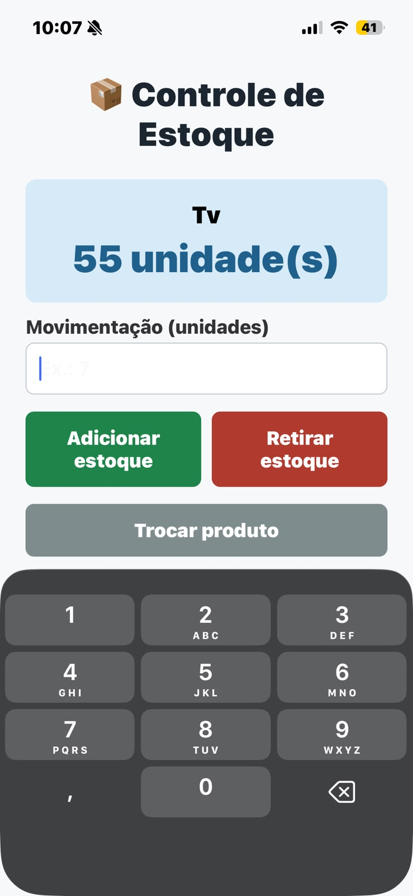

# Questão 03 — Controle de Estoque

Aplicativo React Native (Expo) que controla a quantidade disponível de um produto.

## Funcionalidades
- Nome do produto, quantidade inicial e movimentação
- Botões **Adicionar estoque** e **Retirar estoque**
- Impede retirada maior que o disponível
- Alerta quando restam menos de 5 unidades (20 − 7 → 13 unidades)

## Como executar
```bash
npx create-expo-app@latest q03-estoque --template blank
cd q03-estoque
# substitua o App.js pelo deste projeto
npx expo start
```
Abra com o **Expo Go** (QR code) ou cole o `App.js` em https://snack.expo.dev.

## Capturas de tela

<div align="center">
  
  
  
  
  
</div>
