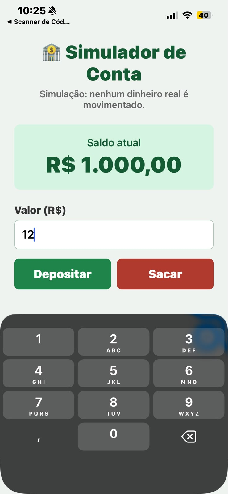

# Questão 05 — Simulador Bancário

Aplicativo React Native (Expo) que simula uma conta com saldo inicial de R$ 1.000,00 (sem dinheiro real).

## Funcionalidades
- Campo de valor e botões **Depositar** e **Sacar**
- Saldo atualizado na tela (+200 − 150 → R$ 1.050,00)
- Bloqueia saque maior que o saldo e valores não positivos

## Como executar
```bash
npx create-expo-app@latest q05-simulador-bancario --template blank
cd q05-simulador-bancario
# substitua o App.js pelo deste projeto
npx expo start
```
Abra com o **Expo Go** (QR code) ou cole o `App.js` em https://snack.expo.dev.

## Capturas de tela

<div align="center">
  
  
  
</div>
