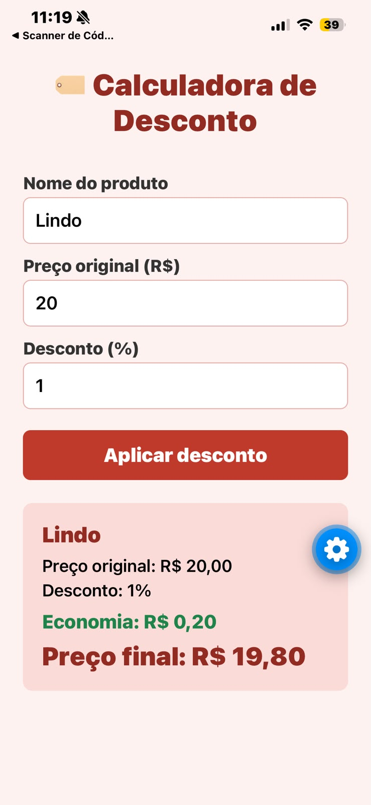

# Questão 07 — Calculadora de Desconto

Aplicativo React Native (Expo) que calcula o preço final após desconto percentual.

## Funcionalidades
- Nome do produto, preço original e percentual; botão **Aplicar desconto**
- Mostra economia e preço final (R$ 200,00 com 15% → economia R$ 30,00; final R$ 170,00)
- Validação: preço não negativo e desconto entre 0% e 100%

## Como executar
```bash
npx create-expo-app@latest q07-desconto --template blank
cd q07-desconto
# substitua o App.js pelo deste projeto
npx expo start
```
Abra com o **Expo Go** (QR code) ou cole o `App.js` em https://snack.expo.dev.

## Capturas de tela

<div align="center">
  
</div>
