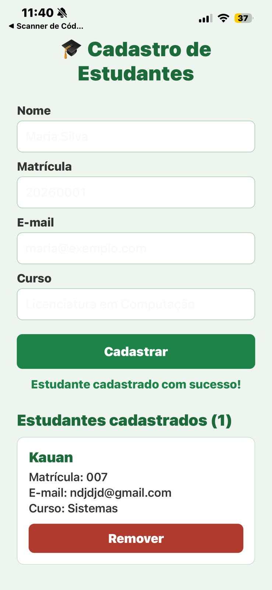

# Questão 08 — Cadastro de Estudantes

Aplicativo React Native (Expo) para cadastrar e consultar estudantes.

## Funcionalidades
- Campos: nome, matrícula, e-mail e curso
- Cria um objeto `{ nome, matricula, email, curso }` e adiciona a um array
- Exibe cards com `map()`
- Impede matrícula duplicada, valida campos obrigatórios e permite remoção

## Como executar
```bash
npx create-expo-app@latest q08-cadastro-estudantes --template blank
cd q08-cadastro-estudantes
# substitua o App.js pelo deste projeto
npx expo start
```
Abra com o **Expo Go** (QR code) ou cole o `App.js` em https://snack.expo.dev.

## Capturas de tela

<div align="center">
  
</div>
