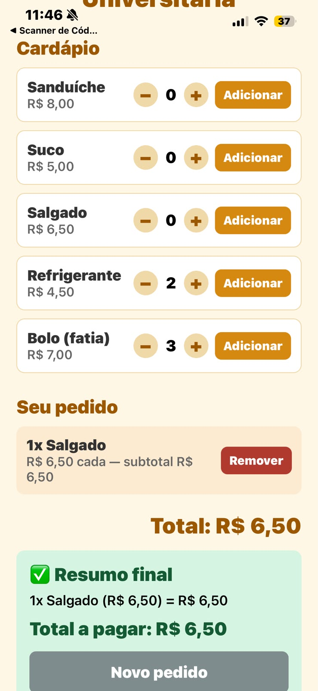

# Questão 09 — Lanchonete Universitária

Aplicativo React Native (Expo) para montar pedidos.

## Funcionalidades
- Cardápio com 5 produtos (nome e preço) e seleção de quantidade (+ / −)
- Itens do pedido armazenados como objetos em um array
- Subtotal por item, total geral, remoção de itens e resumo final
- Exemplo: 2 sanduíches de R$ 8,00 + 1 suco de R$ 5,00 → R$ 21,00

## Como executar
```bash
npx create-expo-app@latest q09-lanchonete --template blank
cd q09-lanchonete
# substitua o App.js pelo deste projeto
npx expo start
```
Abra com o **Expo Go** (QR code) ou cole o `App.js` em https://snack.expo.dev.

## Capturas de tela

<div align="center">
  
</div>
